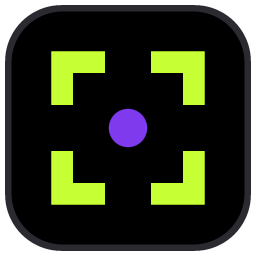

<p align="center"></p>

# Snappy

Capture d'écran légère pour macOS et Windows, 100 % Rust (egui), inspirée de
Screenpresso, avec des annotations **non destructives**.

- **⌘⇧2** : capture de zone. **Tous les écrans** sont figés à l'appui.
  - Survol : la fenêtre sous la souris est encadrée, un **clic la capture**. Un clic
    tout en haut de l'écran ou sur le bureau prend l'écran entier.
  - Glisser : une zone libre, ajustable avec les poignées ou les flèches.
  - Molette : zoom sur l'écran figé ; 0 : taille réelle. Une loupe montre les pixels
    et la couleur visée (C copie le code hexadécimal).
  - M : inclure ou non le curseur de la souris ; H : aide.
  - Entrée, ⌘C ou double-clic : copier ; ⌘S : enregistrer ; E : annoter ;
    Échap : annuler.
- **⌥⇧⌘2** : la **même zone que la fois précédente**, sans sélection (copiée tout de
  suite).
- **⌘⇧1** : l'écran entier (celui du curseur), copié et ouvert dans l'éditeur.
- **Capture différée** (menu de la barre des menus, 3 s par défaut) : le temps
  d'ouvrir un menu ou un survol ; le compte à rebours s'affiche à côté de l'icône.
- **Éditeur** (la touche de chaque outil entre parenthèses) :
  - **flèches** (A) simple, double, grosse flèche ou connecteur ; la poignée du milieu
    les **courbe** ;
  - ligne (L), rectangle (R) à coins carrés ou **arrondis**, ellipse (O), pleins ou non ;
  - surligneur (H), **projecteur** (F, assombrit tout le reste), **flou** (B),
    pixelisation (X), crayon (P) ;
  - texte (T), sur fond ou non ; **bulle** (U) avec une pointe déplaçable ;
  - pastilles numérotées (N) : un glisser leur donne une **pointe** vers l'élément ;
  - **loupe** (M) qui grossit une zone ×2, ×3 ou ×4 ; **tampons** (K) : validé,
    refusé, attention, pointeur, clic, idée… ;
  - **ombre portée** au choix ; 8 couleurs, couleur personnalisée en **hexadécimal**,
    **pipette** (bouton ou Alt+clic) ; 3 tailles (1, 2, 3) ;
  - **poignées** pour éditer après coup (bouts, coins, pointes, loupe) ; ⌘D ou
    Alt+glisser pour **dupliquer** ; ⌘] / ⌘[ pour le **premier plan / arrière-plan** ;
    clic droit pour le menu ;
  - **favoris** (étoile) : l'outil et son style en un clic ; l'éditeur retient aussi le
    dernier outil et le dernier style ;
  - ⇧ contraint les traits à 45° et les rectangles en carrés ; double-clic sur un texte
    ou une bulle pour le modifier.
- **Non destructif** : l'image d'origine n'est jamais modifiée. Les annotations sont
  enregistrées à côté (`.json`) et on peut les retoucher plus tard.
- **Ce qu'on voit est ce qu'on exporte** : un seul moteur de rendu (tiny-skia) sert à
  l'écran, au presse-papiers et aux fichiers.

## Ajouts inspirés de Screenpresso

Détail, décisions en attente et limites : [etat-des-lieux.md](etat-des-lieux.md).

- **Icône** : clic gauche → **Espace de travail** (vignettes annotées, recherche,
  filtres par type et par date, espaces de travail, glisser vers le Finder ou Mail,
  Publier) ; clic droit → le menu complet.
- **Nouvelles captures** (raccourci au choix dans les Réglages) : tous les écrans,
  fenêtre active, **capture avec défilement**, **copier le texte (OCR)**, **QR code**,
  **pipette**, **vidéo** d'une zone (macOS 15+), capture différée. Dans la sélection :
  F écran entier, O pipette, D hexadécimal/décimal.
- **Éditeur** : opacité, pointillés, texte gras/italique/souligné/halo, polygone (G),
  accolade (J), tampons texte et souris, images insérées, sélection multiple et
  alignement, préréglages par outil, onglet **Image** (recadrer, pivoter ⌘R, couper une
  bande, redimensionner, zone de travail, bordures et effets), OCR, flou des données
  sensibles, suppression de l'arrière-plan, partage, impression, document PDF/HTML/GIF.
- **Réglages** en onglets : « Ensuite » (que faire après une capture), contenu du
  presse-papiers, format (PNG, JPEG, WebP…), modèle de nom, démarrage avec la session,
  filigrane, vidéo. Par défaut, Snappy se comporte comme avant.

## Très peu de mémoire

Un seul exécutable, plusieurs processus :

| Processus | Rôle | Mémoire |
|---|---|---|
| `snappy` | l'**agent**, dans la barre des menus, sans fenêtre ni icône dans le Dock | ≈ 10 Mo |
| `snappy --capture region` | la sélection de zone, lancée par l'agent | quelques secondes, puis rendue au système |
| `snappy --edit <png>` | l'éditeur | rendue au système à la fermeture |

Mesuré sur un Mac M4 (build release) : binaire de 4,9 Mo ; l'agent occupe 10 Mo
(`phys_footprint`, la valeur d'Activity Monitor) ; une capture Retina prend environ 35 à
65 ms.

## Construire

```sh
cargo build --release          # target/release/snappy
sh tools/bundle_macos.sh       # dist/Snappy.app
```

Au premier lancement, macOS demande l'autorisation **Enregistrement de l'écran**
(Réglages Système > Confidentialité et sécurité). Sans elle, la capture ne montre que le
fond d'écran. La signature est ad hoc : macOS peut redemander l'autorisation après une
recompilation.

## Windows 10 et 11

```sh
cargo xwin build --release --target x86_64-pc-windows-msvc   # depuis le Mac
```

Le résultat est un seul `snappy.exe` d'environ 6 Mo. Il ne demande ni installation ni
redistribuable (CRT statique), et ne nécessite aucune autorisation particulière.

- Raccourcis, comme Screenpresso : **Impr. écran** pour une zone, **Maj+Impr. écran**
  pour la zone précédente, **Ctrl+Alt+Maj+Impr. écran** pour l'écran entier. Si Windows réserve déjà Impr. écran à l'outil Capture d'écran
  (réglage par défaut sous Windows 11), désactive « Utiliser la touche Impr. écran pour
  ouvrir la capture d'écran » dans Paramètres > Accessibilité > Clavier, ou change le
  raccourci dans **Réglages…**.
- Capture par GDI : aucune bordure jaune, aucune autorisation. Les vidéos protégées
  (Netflix…) apparaissent en noir, comme avec tous les outils de capture.
- Exe non signé : au premier lancement, SmartScreen affiche « Windows a protégé votre
  ordinateur ». Clique sur **Informations complémentaires > Exécuter quand même**.
- Rendu OpenGL (glow) : il faut un pilote graphique, ce qui est le cas de tout PC
  récent. Il manque parfois dans une machine virtuelle sans accélération 3D.
- Données : `%APPDATA%\Snappy\data\` ; images enregistrées : `Images\Snappy`.

## En ligne de commande

```sh
snappy                       # lance l'agent
snappy --region              # capture de zone (via l'agent s'il tourne)
snappy --region --delay 3    # la même, dans 3 secondes
snappy --previous            # la même zone que la fois précédente
snappy --settings            # la fenêtre des réglages (raccourcis, curseur, délai, dossier)
snappy --screen              # écran entier, puis l'éditeur
snappy --edit capture.png    # ouvre une capture dans l'éditeur
snappy --export capture.png sortie.png   # aplatit capture + annotations, sans fenêtre
snappy --capture <action>    # region, screen, previous, all-screens, window, delayed,
                             # scrolling, ocr, qr, color-picker, video, video-region, workspace
snappy --ocr image.png       # texte d'une image ; --qr pour les QR codes
snappy --play video.mp4      # lecteur (découpe, vitesse, GIF)
snappy --share|--mail|--print fichier…   # partage, courriel, impression
snappy --document a.png b.png            # générateur de documents
snappy --quit                # arrête l'agent
```

Pour essayer avec des données jetables : `SNAPPY_DATA_DIR=/tmp/snappy-essai snappy`.

## Fichiers

- `~/Library/Application Support/Snappy/config.json` : les raccourcis
  (`region_hotkey`, `screen_hotkey`, `previous_hotkey`, au format de `global-hotkey`,
  ex. `"super+shift+Digit2"`), le curseur dans les captures (`capture_cursor`), le
  délai de la capture différée (`delay_seconds`) et le dossier d'export (`save_dir`).
  **Réglages…** (menu de la barre des menus, ou `snappy --settings`) les modifie sans
  relancer Snappy.
- `~/Library/Application Support/Snappy/editor.json` : le dernier outil, le dernier
  style et les favoris de l'éditeur.
- `~/Library/Application Support/Snappy/captures/` : l'historique, avec les images
  d'origine et leurs annotations.
- `~/Pictures/Snappy/` : les images enregistrées (⌘S).

## Limites actuelles

- Windows : compilé et testé sous Wine (tests, export), mais la capture d'écran
  elle-même n'a pas encore été essayée sur un vrai PC.
- Une sélection reste sur un seul écran (tous les écrans sont figés, mais une zone ne
  peut pas être à cheval sur deux). Plusieurs écrans : pas encore testé en vrai.
- La détection au survol porte sur les fenêtres, pas encore sur les éléments à
  l'intérieur (boutons, panneaux).
- Les ajouts Screenpresso n'ont pas encore été essayés à la souris (voir
  etat-des-lieux.md § 8) ; la vidéo demande macOS 15 et n'existe pas encore sous
  Windows.

## Crédits

Polices Outfit et Unbounded (OFL), icônes Lucide (ISC/MIT), symboles de DejaVu Sans.
Voir `assets/fonts/`.

Licence : MIT.
